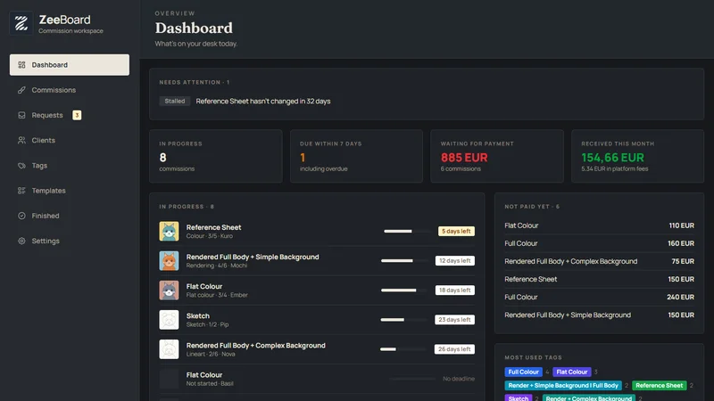
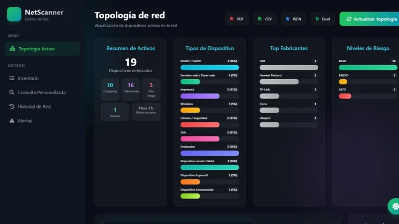
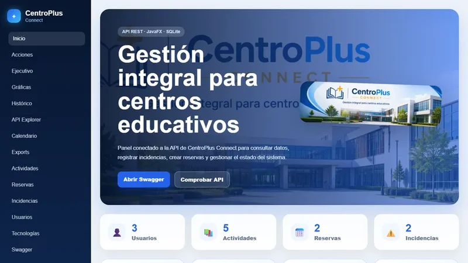

<h1 align="center">Hola, soy Alejandro Donate García 👋</h1>
<h3 align="center">Estudiante de 2º de DAM · Desarrollador junior</h3>

  

  Me gusta construir las cosas de principio a fin: desde una app de escritorio para llevar mis comisiones de arte hasta un escáner de red hecho en equipo.

  <a href="https://alejandrodongar.github.io/">🌐 Ver mi portfolio</a>

---

## 🚀 Proyectos

<table>
  <tr>
    <td width="33%" valign="top">
      
      <h3>ZeeBoard</h3>
      
Gestor de comisiones para artistas: solicitudes, clientes, etapas con imágenes, pagos y estadísticas. App de escritorio local.

      
TypeScript · React · Tauri · SQLite

      
<a href="https://alejandrodongar.github.io/zeeboard/">🌐 Web</a> · <a href="https://github.com/alejandroDonGar/zeeboard">💻 Código</a>

    </td>
    <td width="33%" valign="top">
      
      <h3>NetScanner</h3>
      
Descubrimiento e inventariado de redes locales con topología, riesgo, confianza y alertas. Proyecto de equipo.

      
Python · Django · MongoDB · Scapy

      
<a href="https://alejandrodongar.github.io/netscanner/">🌐 Web</a> · <a href="https://github.com/alejandroDonGar/netscanner">💻 Código</a>

    </td>
    <td width="33%" valign="top">
      
      <h3>CentroPlus Connect</h3>
      
Gestión de usuarios, actividades, reservas e incidencias de un centro educativo: web, app JavaFX y API REST.

      
Java · Spring Boot · JavaFX · Swagger

      
<a href="https://alejandrodongar.github.io/centroplus-connect/">🌐 Web</a> · <a href="https://github.com/alejandroDonGar/centroplus-connect">💻 Código</a>

    </td>
  </tr>
</table>

---

## 🧰 Tecnologías

  
  
  
  
  
  
  
  
  
  
  
  
  
  
  
  
  
  
  

---

## 🎓 Asignaturas de 2º DAM

Ver los repositorios de clase

<table>
  <tr>
    <td width="33%" valign="top">
      <h4>📊 Acceso a Datos</h4>
      
Java con Maven, ficheros CSV, JSON y XML, properties y CI con GitHub Actions.

      
  

      
<a href="https://github.com/alejandroDonGar/Acceso-a-Datos-2026---2027">💻 Ver repositorio</a>

    </td>
    <td width="33%" valign="top">
      <h4>🎨 Desarrollo de Interfaces</h4>
      
Fundamentos de Flutter y Dart: widgets, layouts y estilos.

      
 

      
<a href="https://github.com/alejandroDonGar/Desarrollo-de-Interfaces-2026---2027">💻 Ver repositorio</a>

    </td>
    <td width="33%" valign="top">
      <h4>🚀 Despliegue de Aplicaciones Web</h4>
      
Prácticas documentadas con uv y Zensical, publicadas en GitHub Pages.

      
 

      
<a href="https://github.com/alejandroDonGar/Despliegue-de-Aplicaciones-2026---2027">💻 Ver repositorio</a>

    </td>
  </tr>
  <tr>
    <td width="33%" valign="top">
      <h4>⚙️ Programación de Servicios y Procesos</h4>
      
Procesos y concurrencia en Python con os.fork y os.wait.

      

      
<a href="https://github.com/alejandroDonGar/Programacion-de-Servicios-y-Procesos">💻 Ver repositorio</a>

    </td>
    <td width="33%" valign="top">
      <h4>📱 Programación Multimedia y Dispositivos Móviles</h4>
      
Mini-Pokédex retro en JavaScript consumiendo PokéAPI, con búsqueda y filtros.

      
  

      
<a href="https://github.com/alejandroDonGar/Programacion-multimedia-y-dispositivos-moviles-2026---2027">💻 Ver repositorio</a>

    </td>
    <td width="33%"></td>
  </tr>
</table>

---

## 📫 Contacto

  
  
  

